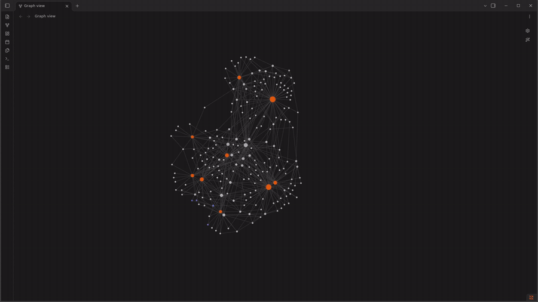

# Cribrum

Cribrum turns the exported history of a group chat into an Obsidian vault where you can see what people actually talk about, and how the same themes show up across different groups. It also has a small semantic search over the messages. Everything runs offline, on a laptop CPU.

This is a personal project. I am in a lot of university group chats, and I wanted to see what was going on in them: which questions come back every year, what each course group cares about, and which themes are shared by all of them (exams, grades, finding a project group, recordings). Reading thousands of messages by hand was not an option, so I built this.

At the moment only Telegram is supported, through the JSON export of a chat. Only the text of the messages is used: photos, screenshots, voice messages and files are kept as "media" messages, but their content is not read (no OCR, no transcription). The ingest layer is written so that other sources (WhatsApp, Discord) can be added as new adapters, and that is something I plan to do.

## What you get

<!--
Demo video: drag the .mp4 into this file while editing it on github.com,
GitHub uploads it and puts the link here. GIFs and images go in docs/assets/.
-->



The vault has one note per chat, one note per shared theme (a *facet*), and one note for every (chat, facet) pair, which quotes the conversations of that chat about that theme. In the graph view, chats are connected to each other through the facets they share, and each chat also has its own local concepts.

On my 9 chats (about 32k messages since 2023) the pipeline produces about 9.5k conversation windows, 211 topics and 93 facets, 37 of which are shared by at least two chats.

## How it works

```text
Telegram export (JSON)
  -> conversation windows      messages grouped into short conversations
  -> window embeddings         one multilingual-e5-base vector per window
  -> topics per chat           BERTopic (UMAP + HDBSCAN + c-TF-IDF)
  -> facets across chats       topics of all chats clustered together
  -> Obsidian vault            chats, facets, quoted conversations
```

Every step reads files and writes files, in a folder named after the hash of its configuration. You can stop after any step, look at the output, change a parameter and rerun only that step, and keep different configurations side by side.

Nothing in the code is specific to my chats: the number of facets, their names and whether they are shared are all computed from the data. Thresholds and word lists live in `config/`.

### The baseline: a decision tree that builds the conversations

The hardest part is the first one. In a group chat, messages from different conversations are mixed together, and only some of them are explicit replies. Grouping by time alone ("same conversation if less than 10 minutes apart") is wrong about one time in three.

In this first version, the windows are built greedily: explicit replies, bursts by the same author and short acknowledgements ("ok", "thanks") are linked by rules, and for everything else a small decision tree decides whether a message continues the previous one or starts something new. It uses 17 cheap features: time gap, author, whether it is a question, word overlap with the last messages, and a few more.

I labelled pairs of messages by hand and measured everything with leave-one-chat-out cross-validation, so each chat is predicted by a model that never saw it:

| method | balanced accuracy |
|---|---|
| time gap only | 0.69 |
| decision tree, depth 5 | 0.88 |
| decision tree + always merge under 120 s | **0.89** |

Logistic regression, random forest and gradient boosting were not better, and neither were extra features such as embedding similarity. The ablation and the error analysis are in the Italian docs. The trained tree is in `data/models/merge_model.pkl`.

This is a baseline. It can only link a message to the one right before it (or to the one it replies to), so interleaved conversations are still a problem. See [Future work](#future-work).

### Search

There is also a semantic search: messages and question/answer threads are embedded and stored in ChromaDB, and `search` returns the closest ones to a question. It works, but it is the older and simpler part of the project.

## Quickstart

You need [uv](https://docs.astral.sh/uv/) and Python 3.12.

```bash
git clone https://github.com/Francesco2035/cribrum.git
cd cribrum
uv sync
```

The first run downloads the embedding model (`intfloat/multilingual-e5-base`). After that, set `HF_HUB_OFFLINE=1` and nothing goes to the network.

1. Export each chat from Telegram Desktop: open the chat, menu, *Export chat history*, and choose the **JSON** format ("Machine-readable JSON"), not HTML. Media are not needed, you can untick photos, videos and files. Put the `result.json` in `data/exports/<name>.json`, where `<name>` is the short name you will use in the commands.
2. Optionally, mark general (non-course) chats in `config/windows.yaml` under `chat_types`. They are slower and get a larger time threshold.
3. Run the pipeline for each chat, then build facets and the vault once:

```bash
export HF_HUB_OFFLINE=1

uv run python -m cli.main windows <name> --merge-model data/models/merge_model.pkl   # prints data/windows/<name>/<hash>
uv run python -m cli.main embed data/windows/<name>/<hash>
uv run python -m cli.main discover data/windows/<name>/<hash>                       # small chats: --min-topic-size 5

uv run python -m cli.main facets
uv run python -m cli.main export
```

4. In Obsidian, *Open folder as vault* and pick `vault/`.

All commands and options are in [docs/usage.md](docs/usage.md). A longer description of each step is in [docs/pipeline.md](docs/pipeline.md).

### Privacy

Chat exports and the generated vault contain real messages and names. They are in `.gitignore` and should stay private. The published labels (`data/labels/`) only contain message ids, time gaps and the label, no text.

## Project layout

```text
cli/        command line interface (Typer), only orchestration
core/       all the logic: ingest, windows, merge model, topics, facets, vault, search
config/     parameters and word lists (YAML)
data/       exports, labels, derived outputs (mostly ignored by git)
docs/       usage, pipeline, future work; docs/it/ has the detailed docs in Italian
scripts/    tuning scripts
tests/      pytest
```

## Documentation

- [docs/usage.md](docs/usage.md): every command.
- [docs/pipeline.md](docs/pipeline.md): what each step does and why.
- [docs/future_work.md](docs/future_work.md): what I want to improve, and how to measure it.
- [docs/it/](docs/it/): the detailed documentation, one page per source file with the same structure as the code (`docs/it/code/core/windows.md` documents `core/windows.py`), plus notes on libraries and tuning. For now it is written in Italian.

## Future work

The main directions, roughly in order. The full list, with how each idea would be measured, is in [docs/future_work.md](docs/future_work.md).

- **Better windows with conversation disentanglement.** Instead of linking a message only to the previous one, link it to any recent conversation, or score all pairs of nearby messages and cluster them. This is the classic *conversation disentanglement* problem:
  - M. Elsner and E. Charniak. [You Talking to Me? A Corpus and Algorithm for Conversation Disentanglement](https://aclanthology.org/P08-1095/). ACL 2008.
  - J. K. Kummerfeld et al. [A Large-Scale Corpus for Conversation Disentanglement](https://aclanthology.org/P19-1374/). ACL 2019.
  - T. Yu and S. Joty. [Online Conversation Disentanglement with Pointer Networks](https://aclanthology.org/2020.emnlp-main.512/). EMNLP 2020.

  It needs a different kind of label ("which earlier message does this one answer?") and metrics on whole conversations, not just pairs.
- **Better search.** Search over conversation windows instead of single messages and reply threads, add keyword search (BM25) next to the embeddings, and put a local LLM on top (for example through Ollama) that answers using only the retrieved windows.
- **More labels and confidence intervals**, so that small differences between models can actually be measured.
- **Stable facets.** Today facets are recomputed from scratch, so ids and names can change when a chat is added. Freezing them and matching new runs to old ones would make the vault incremental.
- **Professors and courses as nodes** in the graph.
- **Readable names** for topics and facets, proposed by a local LLM next to the keywords.
- **More sources**: WhatsApp and Discord adapters.
- **Media content.** OCR on screenshots and photos of exercises (very common in course chats) and transcription of voice messages, so that they count as text too.

## Contributing

Contributions are welcome: new chat sources, better windowing, evaluation, or just bug reports. See [CONTRIBUTING.md](CONTRIBUTING.md).

## License

[MIT](LICENSE)
